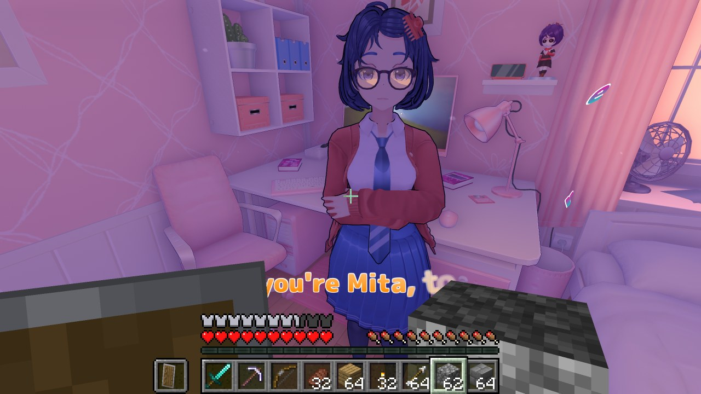

# MiSideCraft



Play MiSide as Steve. You walk, jump and fall with Minecraft's physics, carry Minecraft's
inventory and HUD, and place and break blocks in Mita's world. What the characters say shows up
in Minecraft's chat.

Neither game is rewritten. MiSide runs its world, its characters and its story; Minecraft runs
its own game logic next to it, hidden. A BepInEx plugin in MiSide and a Fabric mod in Minecraft
talk to each other through shared memory, and MiSide draws everything.

> **Status: early and experimental.** Expect rough edges, and back up your saves
> (`%USERPROFILE%\AppData\LocalLow\AIHASTO\MiSideFull`).
> This is a fan project. It isn't affiliated with AIHASTO, IndieArk, Mojang or Microsoft, and you
> need to own both games.

## What works

- **Movement:** Minecraft movement on MiSide's floors, furniture and stairs: walking, sprinting,
  jumping, sneaking, swimming and falling. MiSide's walls and floors are felt out around you and
  fed into Minecraft's own collision.
- **Minecraft's picture in MiSide's:** the HUD, your hand and held item, the inventory, chat and
  every other Minecraft screen, drawn over MiSide's frame.
- **Blocks:** place and break blocks anywhere. They're drawn inside MiSide's picture in 3D and hide
  behind MiSide's walls and furniture like they belong there. Torches, lanterns and lava light
  up the room.
- **Using MiSide's things:** right-click what MiSide's player would use (doors, switches, items).
  When you look at one of your own blocks, the right-click is Minecraft's instead.
- **The characters:** Mita and the others have an invisible stand-in in Minecraft: you bump into
  them, and when you hit them they're knocked back.
- **Dialogue in chat:** what the characters say goes into Minecraft's chat, like a player
  talking (`<Mila Glasses> You've ruined the entire route!`).
- **Scenes stay MiSide's:** when the story takes the player (a cutscene, a conversation, an
  animation), MiSide gets control back, and Steve takes over again a moment after.
- **F6** switches between Steve and MiSide's own player at any time.
- **A Minecraft world of your own:** a Survival world is made on your PC, with a starter kit, a
  builder's kit, a home kit for Mita's world (a pink bed, cake, flowers, a jukebox) and a guide
  book.
- **Pause menu:** Escape in Minecraft mode opens a pause menu with your advancements, Minecraft's
  options and MiSide's own menu. MiSide stands still while it is open.
- **Commands:** `/mita` (or `/tp mita`) brings that character to you, `/summon mita` makes another
  one of her; the same for `kind`, `cappie`, `mila`, `short_hair`, `sleepy` and `chibi`, when
  she is somewhere in the current chapter. Plus `/repairworld`, `/experiment` and Minecraft's own.

## Requirements

- **MiSide** on Steam (Windows).
- **Minecraft: Java Edition**, a Microsoft account that owns it. MiSideCraft brings its own
  launcher (Prism Launcher), which downloads Minecraft and Java for you.
- About 4 GB of RAM to spare for Minecraft next to MiSide.

## Installing

1. **Download `MiSideCraft-<version>.zip`** from the releases.
2. **Open MiSide's folder:** in Steam, right-click MiSide, choose **Manage**, then
   **Browse local files**. That's `Steam\steamapps\common\MiSide` (where `MiSideFull.exe` is).
3. **Unpack the zip into that folder**, so that `BepInEx`, `winhttp.dll` and
   `doorstop_config.ini` sit next to `MiSideFull.exe`. Allow it to replace files if it asks.
4. **Start MiSide from Steam.** The first start takes a minute longer: BepInEx prepares itself
   once.
5. **Sign in to Minecraft, once.** MiSideCraft unpacks its Minecraft to
   `%LOCALAPPDATA%\MiSideCraft`, and a small **Prism Launcher** window asks for your Microsoft
   account. Alt-Tab to it, sign in, then go back to MiSide. Prism downloads Minecraft, Fabric and
   Java (a few minutes, first time only). The corner of MiSide's screen says what Minecraft is
   doing.
6. **Load a save and play.** As soon as Minecraft is in its world, you are Steve. Press **F6** to
   switch to MiSide's own player and back.

After that it's automatic: Minecraft starts with MiSide, hidden, opens its world by itself, and
closes with MiSide.

**Updating:** unpack the new zip over the old one. The next start updates the Minecraft side too
and keeps your sign-in and your world.

**Uninstalling:** delete `BepInEx`, `winhttp.dll`, `doorstop_config.ini`, `.doorstop_version`,
`changelog.txt` and `dotnet` from MiSide's folder (or let Steam verify the game's files), then
delete `%LOCALAPPDATA%\MiSideCraft`. That folder holds Prism, your Microsoft sign-in (Prism's),
Minecraft's files and your MiSideCraft world.

### Using your own launcher

`BepInEx\plugins\MiSideCraft\MiSideCraft.ini` chooses which Minecraft MiSide starts:

```ini
Minecraft = prism   ; the Prism Launcher that comes with MiSideCraft
Minecraft = none    ; start Minecraft yourself; MiSide waits for it
```

With `none`, your instance needs Minecraft 26.3, Fabric Loader 0.19.5 or newer, Fabric API,
Java 25 and `misidecraft-fabric-<version>.jar` (from the release), plus
`-Dskycraft.passthrough=true` in its JVM arguments (and `-Dskycraft.startHidden=true` to keep its
window hidden). MiSideCraft never starts a second Minecraft if one with the mod is running.

## Controls

Minecraft has priority while you are Steve:

| Key | Does |
|---|---|
| **Right mouse** | Use what MiSide's player looks at (a door, a switch, an item); otherwise Minecraft's use/place |
| **Left mouse** | Minecraft's attack and break, also on the characters |
| **Esc** | The pause menu (or closes an open Minecraft screen) |
| **F6** | Switch between Steve and MiSide's own player |

Every other key is Minecraft's: **WASD**, **Space** jump, **Shift** sneak, **Ctrl** sprint,
**E** inventory, **T** chat, **/** commands, **1-9** hotbar, and so on.

## Known limitations

- **F5** (third person) isn't drawn yet: the camera stays at Steve's eyes.
- MiSide's minigames and scenes with their own controls are played as MiSide's player: the game
  takes control for them, and Steve comes back afterwards.
- Characters are knocked back by hits, but they don't fight back and can't be hurt. Minecraft's
  tricks on characters (leads, buckets, pumpkins) aren't hooked
  up on MiSide's side yet.
- Blocks are kept per Minecraft world, not per MiSide save or chapter, so blocks placed in one
  room can show up in another room at the same spot.
- What the characters say reaches the chat in English (and other languages written in Latin
  letters); other languages stay out of the chat.
- If something goes wrong, `BepInEx\LogOutput.log` (lines from MiSideCraft) and
  `BepInEx\plugins\MiSideCraft\MiSideCraft.log` say what. Minecraft's own log is
  `%LOCALAPPDATA%\MiSideCraft\Prism\instances\MiSideCraft\.minecraft\logs\latest.log`.

## Building from source

You need Visual Studio 2026 (C++), CMake 3.25+, the .NET 8 SDK, JDK 25, and MiSide with BepInEx
run once (the plugin builds against the game's `BepInEx\interop` folder).

```bat
cmake -S ms\native -B ms\native\build -G "Visual Studio 18 2026" -A x64
cmake --build ms\native\build --config Release

dotnet build ms\plugin -c Release -p:Install=true

cd fabric
gradlew build
cd ..

powershell -ExecutionPolicy Bypass -File tools\package.ps1 -NoBuild
```

`-p:Install=true` copies the plugin and its native half into MiSide's `BepInEx\plugins\MiSideCraft`.
With `Minecraft = source` in that folder's `MiSideCraft.ini`, MiSide starts this repo's Fabric
project (`gradlew runClient`) instead of the bundled Minecraft. `tools\package.ps1` builds
everything (drop `-NoBuild`) and writes the release files to `dist\`.

| Folder | |
|---|---|
| `ms/plugin/` | The MiSide half: a BepInEx 6 plugin (C#) for the player, camera, collision, characters, dialogue |
| `ms/native/` | Its native half (C++): the shared memory, Minecraft's picture over MiSide's frame, blocks in 3D, keyboard and mouse, starting Minecraft |
| `fabric/` | The Minecraft Fabric mod (Java) |
| `protocol/` | The shared-memory protocol between them |
| `tools/` | Packaging and diagnostics |

## Credits and license

MiSideCraft is made by Mielesgames, on top of [SkyCraft](https://github.com/chasmlol/SkyCraft) by
chasmlol (Skyrim as Steve), whose shared-memory link, Minecraft mod and block renderer it
builds on. [MIT](LICENSE). See [THIRD-PARTY-NOTICES.md](THIRD-PARTY-NOTICES.md) for what a
release contains.
